# [RenderMan Art Challenge](https://renderman.pixar.com/challenges)

## [2026 Diorama Drama](diorama-drama.md)

## Progress

Work in progress, also posted to the [RenderMan Discord thread](https://discord.com/channels/479703857883250698/1557180427838562304);
the reasoning behind each step is in the ideation notes, [diorama-drama.md](diorama-drama.md).
Click a thumbnail for the full-resolution image (the cloud renders are 3840x2160).
Thumbnails are made with `python3 tools/make_thumbs.py`.

| Date | Images | Notes |
|---|---|---|
| Aug 9 | <a href="outputs/v000_dream_sketch.png">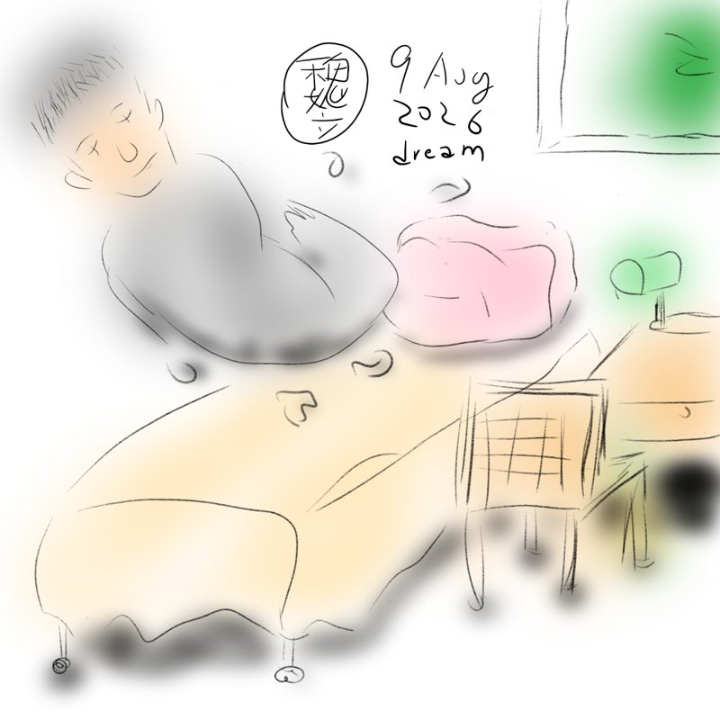</a> | Rough sketch of the dream that inspired this project: myself drifting like a piece of paper during a restless sleep.<br><sub>`v000_dream_sketch`</sub> |
| Oct 6 | <a href="outputs/v000_assets_oni.png">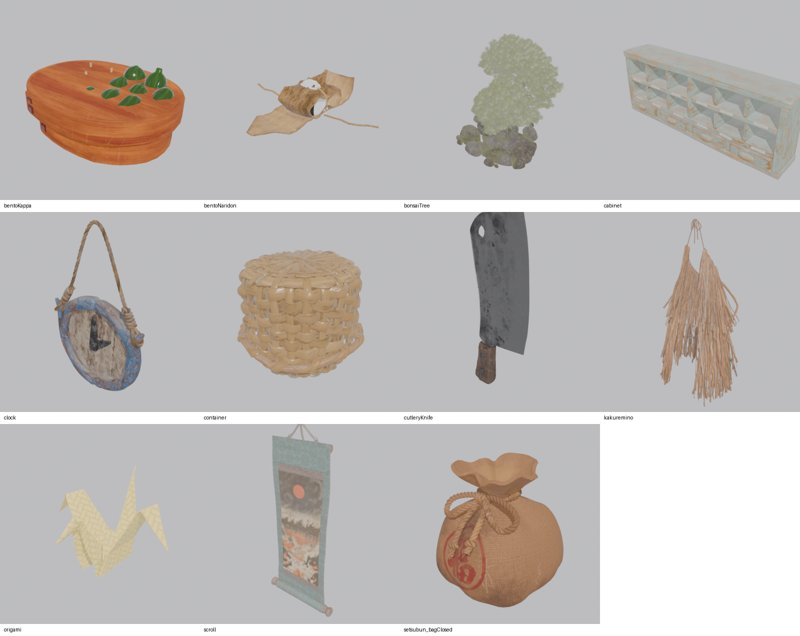</a><br><a href="outputs/v000_character.png">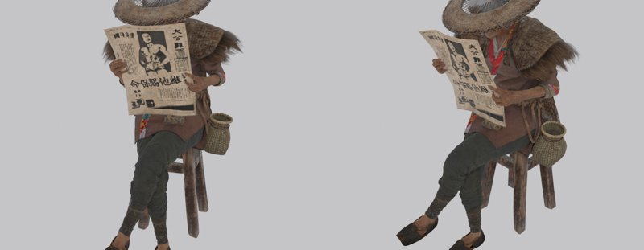</a><br><a href="outputs/v000_sets.png">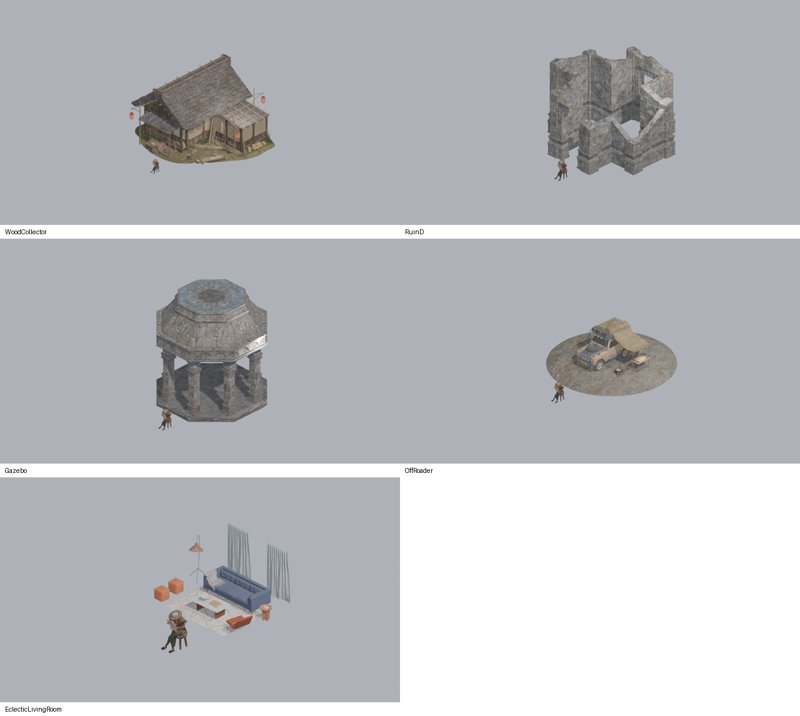</a> | Exploring the challenge assets: the Oni props (a clock, a straw invisibility cape, a Setsubun bean bag, an origami crane), the old woman reading a newspaper from BigMediumSmall who became the center character, and [five KitBash3D sets](diorama-drama.md#kitbash3d-set-candidates) with her for scale; the Wood Collector farmhouse won due to the matching Japanese style.<br><sub>`v000_assets_oni`, `v000_character`, `v000_sets`</sub> |
| Oct 6 | <a href="outputs/v001_prman.png">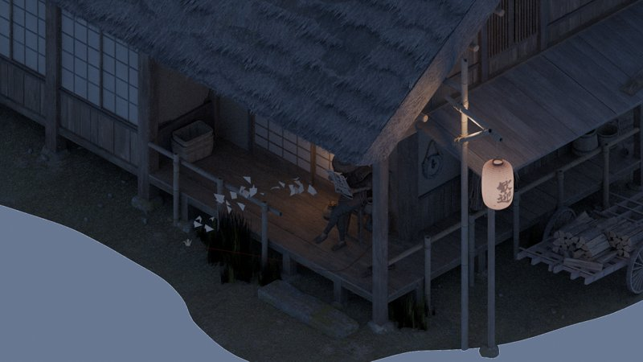</a> | First Blender + RenderMan preview of the story setup, combining the dream with the challenge assets: the old woman reading on the veranda of the Wood Collector house, Oni props, a placeholder paper trail ([concept](diorama-drama.md#concept-paper-soul-working-title-407-am)).<br><sub>`v001_prman`</sub> |
| Oct 7 | <a href="outputs/v002_prman.png">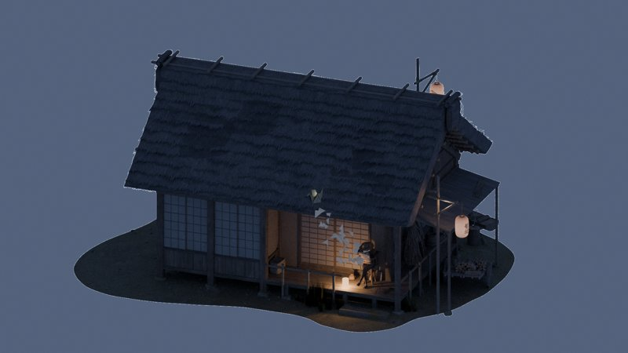</a> | Lower camera, zoomed out to show the whole diorama; the paper trail needs to be larger to read at this scale.<br><sub>`v002_prman`</sub> |
| Oct 7 | <a href="outputs/v002_trail_prman.png">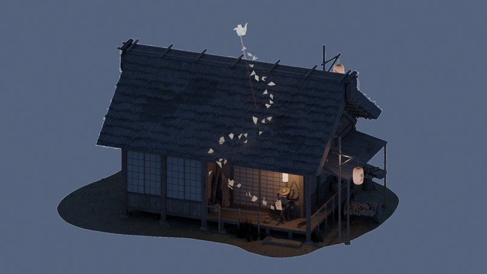</a> | More pronounced paper trail: a wider S-curve over the roof, glowing scraps printed with her newspaper, the crane above the ridge. The reading lantern hangs above her, and the smaller story objects are spread along the veranda ([composition decisions](diorama-drama.md#composition-decisions-oct-67)).<br><sub>`v002_trail_prman`</sub> |
| Oct 7 | <a href="outputs/v003_prman.png"></a> | Her newspaper fractures into the paper trail and glows like the scraps ([fracture plan](diorama-drama.md#next-version-the-newspaper-fractures-into-the-soul)).<br><sub>`v003_prman`</sub> |
| Oct 8 | <a href="outputs/v003_old_props_cloud.png">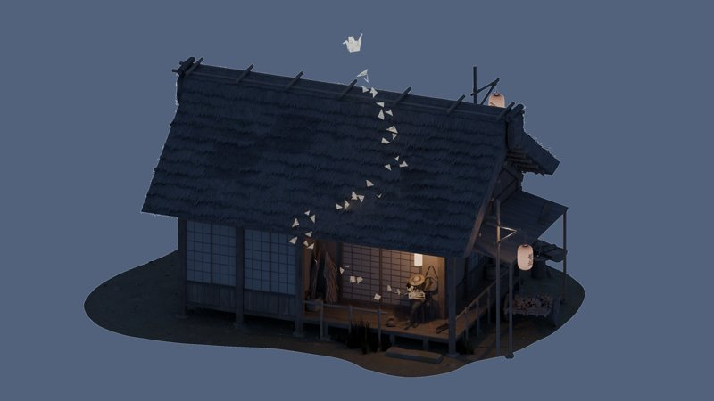</a><br><a href="outputs/v003_old_props_cloud_veranda.png">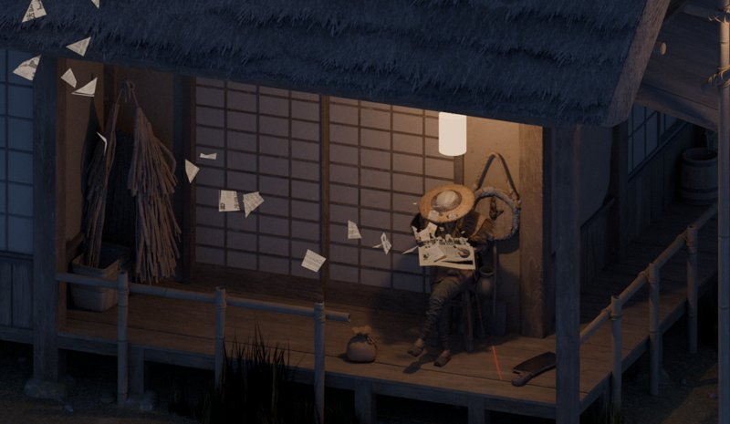</a> | First 4K XPU render on the challenge's cloud farm (Ranch Computing), with the veranda at full resolution below.<br><sub>`v003_old_props_cloud`, `v003_old_props_cloud_veranda`</sub> |
| Oct 8 | <a href="outputs/v003_new_props_cloud.png"></a><br><a href="outputs/v003_new_props_cloud_veranda.png">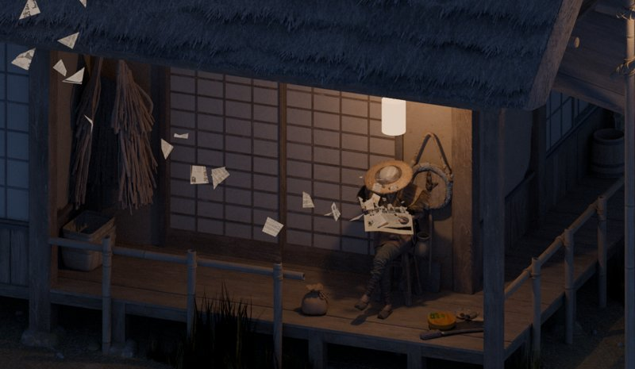</a> | Revised props, 4K XPU: the red string removed; an abandoned meal (cucumber bento, rice ball, cleaver) added; the straw cape hung higher ([decisions](diorama-drama.md#decisions-oct-8)).<br><sub>`v003_new_props_cloud`, `v003_new_props_cloud_veranda`</sub> |
| Oct 9 | <a href="outputs/v003_head_droop_cloud.png"></a><br><a href="outputs/v003_head_droop_cloud_veranda.png">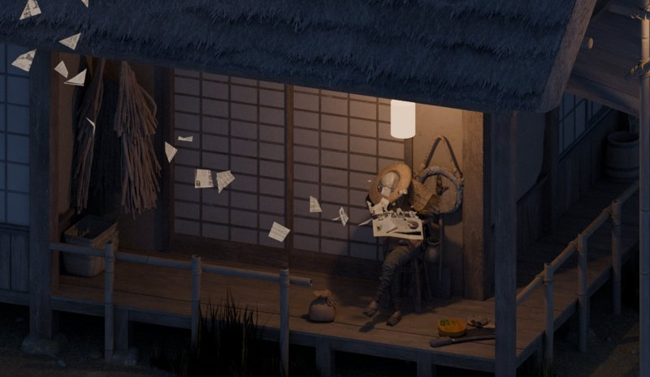</a> | The woman's head droops to her right and forward over the newspaper, so she appears to be dozing off rather than reading (feedback from [leif3d](https://discord.com/users/665483073022066709), likely [Leif Pedersen](https://leif3d.com/), in Discord WIP thread: the link between spirit and sleep wasn't coming through). 4K XPU on the cloud.<br><sub>`v003_head_droop_cloud`, `v003_head_droop_cloud_veranda`</sub> |

## Setup

Challenge assets are licensed for the challenge only and are not in git (`assets/` is gitignored).
Downloads go, unmodified, into `assets/source/`; the scripts generate RenderMan-ready copies into `assets/derived/`, which is all the scenes link to.

| Folder | Source |
|---|---|
| `assets/source/BMS_Pixar-Collab_Assets/` | BigMediumSmall pack (challenge download) |
| `assets/source/Diorama_Drama_Netflix_Megalis/` | Netflix/Tonko House Oni pack (challenge download) |
| `assets/source/KitBash3D/` | KitBash3D via Cargo (search "RenderMan" or "Diorama"), saved as `.blend`: `WoodCollector.blend` (house only), plus candidates `EclecticLivingRoomSet`, `Gazebo`, `OffRoader`, `RuinD` |
| `assets/derived/` | generated by the scripts below (what `scenes/` uses) |

Software (Apple Silicon Mac): RenderMan Pro Server 27.3 and RenderMan for Blender 27.3, which need the **Intel** build of Blender (4.5 LTS, `macos-x64`, runs under Rosetta).
XPU is not available on macOS (RenderMan falls back to RIS), so final XPU renders go through the challenge's cloud rendering.

## Tools

With `B=/Applications/Blender-4.5.9-x64.app/Contents/MacOS/Blender`:

```bash
# Oni props: import .abc geometry + rebuild materials from the .usda (Blender's USD import shows only an empty);
# RenderMan networks are recreated node for node, using the pack's .tex files
$B -b --factory-startup --python tools/import_oni_assets.py -- assets/derived/oni_assets.blend

# RenderMan-ready copies of the KitBash3D set and the character (adds PxrSurface networks, txmakes textures)
$B -b assets/source/KitBash3D/WoodCollector.blend --addons RenderManForBlender \
    --python tools/convert_to_rman.py -- assets/derived/WoodCollector_rman.blend
$B -b "assets/source/BMS_Pixar-Collab_Assets/WaterVillage _6Crowd_Characters/WaterVillage_POSED.blend" --addons RenderManForBlender \
    --python tools/convert_to_rman.py -- assets/derived/OldWoman_rman.blend --keep 31_OldWoman_Sit6_Reading

# The newspaper she reads fractures toward its top edge (OSL shader shaders/PaperFracture.osl, compiled to .oso);
# makes a separate character file, so OldWoman_rman.blend (used by v002) stays intact
$B -b assets/derived/OldWoman_rman.blend --addons RenderManForBlender \
    --python tools/fracture_newspaper.py -- assets/derived/OldWoman_fractured_rman.blend

# Layout: links the assets/derived/ files, so the scene file stays small (v003 = with the fracture)
$B -b --factory-startup --python tools/build_layout.py -- scenes/paper_soul_v003.blend

# Preview through the scene camera (eevee = fast; prman = RenderMan); --report prints object positions in frame;
# --focus x,y,z --ortho SIZE zooms in (e.g. on the newspaper: --focus "-5.45,-2.4,1.75" --ortho 1.2)
$B -b scenes/paper_soul_v003.blend --python tools/preview_scene.py -- build/preview/layout.png
$B -b scenes/paper_soul_v003.blend --addons RenderManForBlender --python tools/preview_scene.py -- build/preview/layout_prman.png --engine prman
```

Final frame (3840x2160, production sampling; the scene is built with `--final`, previews still use quick sampling):

```bash
$B -b --factory-startup --python tools/build_layout.py -- scenes/paper_soul_v003.blend --force --final
$B -b scenes/paper_soul_v003.blend --addons RenderManForBlender -f 1   # -> build/final/paper_soul_v003.0001.png
```

On macOS this renders with RIS (XPU is not implemented there), expect hours, and it is only a backup:
the submission needs XPU, i.e. the challenge's cloud rendering (Ranch Computing, CPU-only XPU; their deadline is
Oct 19 09:00 Paris time) or a Windows/Linux machine.

## Cloud rendering (Ranch Computing)

The challenge's cloud rendering (Ranch Computing, XPU on CPU) takes a `.vub` archive made by their RANCHecker add-on,
which uses RenderMan's own scene packer. Their deadline is **Oct 19, 09:00 Paris time**.

1. **Build the self-contained render scene** (after any change to the scene or assets):

   ```bash
   $B -b --factory-startup --python tools/build_layout.py -- scenes/paper_soul_v003_render.blend --force --final --local
   ```

   `--local` appends everything instead of linking (the packer can't collect our linked libraries in `../assets/derived/`),
   drops Blender's preview images and makes RenderMan paths absolute; the packer then copies the `.tex` files (UDIM tiles
   included) and `shaders/PaperFracture.oso` into the archive. The file is ~400 MB and not in git (`scenes/*_render.blend`).
   It is already set to 3840x2160 at 100%, frame 1, XPU, production sampling.

2. **Install RANCHecker once** (Blender 4.5.9 x64): download *RANCHecker for Blender* from
   <https://www.ranchcomputing.com/en/ranchsync-ranchecker/>, then Edit > Preferences > Add-ons > ⌄ > Install from Disk
   (or copy its `RANCHecker` folder into `~/Library/Application Support/Blender/4.5/scripts/addons/`) and enable it.
   In its add-on preferences, leave **"Use TEX (RenderMan)" off** (that mode copies UDIM paths literally and fails).

3. **Create the `.vub`**: open `scenes/paper_soul_v003_render.blend` in Blender 4.5.9 x64, press **N** in the 3D viewport,
   open the **RANCHECKER** tab, optionally tick *Destination* to choose the output folder (default: Desktop; needs ~5 GB free),
   and click **Prepare project**. Its *Logs* show the result; expect a ~4.4 GB `paper_soul_v003_render.vub`.
   The same can be done headless:

   ```bash
   $B -b scenes/paper_soul_v003_render.blend --addons RenderManForBlender,RANCHecker --python-expr \
       "import bpy; s = bpy.context.scene.ranch_settings; s.destination_bool = True; \
        s.str_destination = '$PWD/build/cloud/'; print(bpy.ops.ranch.create_archive())"
   ```

4. **Upload** the `.vub` with RanchSync (sign in with your API key) or the project page's web upload, then render.
   Check the result for magenta (missing textures) and that the newspaper is fractured (OSL shader loaded).

Gotchas found along the way:

* RANCHecker's RenderMan check looks up the world by the name `World` (`bpy.data.worlds["World"]`), so the scene's
  world must be called that (`build_layout.py` does).
* RANCHecker re-saves the scene file while preparing; that's fine, `paper_soul_v003_render.blend` is regenerated anyway.
* Tested: the unpacked package renders identically locally, and the first cloud render (Oct 8) came back clean.

## Notes

* RenderMan for Blender ignores image textures in plain Blender materials, and its built-in Cycles converter predates Blender 4's Principled BSDF; hence `convert_to_rman.py`.
* Paths are repo-relative, so the repo can be cloned anywhere (or uploaded for cloud rendering) once `assets/` is in place:
  * RenderMan texture paths are written as `<blend_dir>/../assets/...`. RfB expands `<blend_dir>` to the folder of the *scene* file, even for linked libraries, so **scene files must stay in `scenes/`**.
  * Blender image paths inside the repo are relative; KitBash3D preview textures stay absolute in Cargo's `~/.kitbash3d` library (Eevee only; RenderMan uses the `.tex` copies in `assets/derived/`).
* A RfB `RecursionError` traceback from its link-file handler while building the layout is harmless.
* RfB takes per-face materials from the mesh and ignores object-level material slot overrides, so material changes to a linked character go into its asset file (as `fracture_newspaper.py` does), not the scene.
* `shaders/*.oso` is committed with its `.osl` source so the cloud renderer can load it.

`tools/preview_set.py` renders a KitBash3D set with the old woman for scale.
